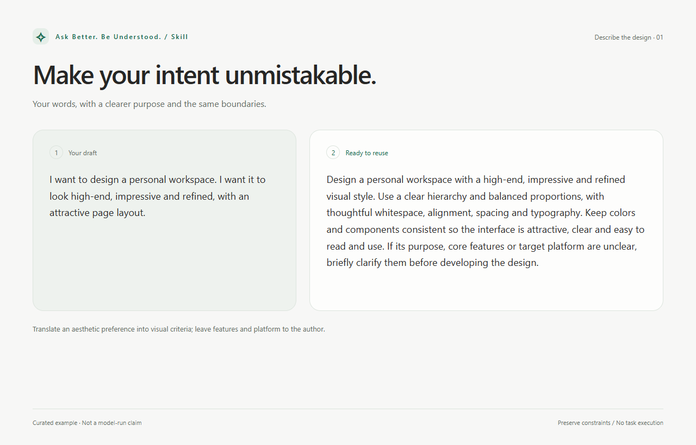

# Ask Better. Be Understood.

[简体中文](README.zh-CN.md) · Skill · 1.0.0-preview.1

**Put your intent into words you can use.**



You know what you want, but the wording is not there yet. Give this skill your draft. It untangles the expression and makes existing requirements easier to understand, returning a prompt you can review and reuse.

## Start with your own words

```text
Use $ask-better-be-understood to clarify this draft:
I want to design a personal workspace. I want it to look high-end,
impressive and refined, with an attractive page layout.
```

The result is still a design request, with clearer visual criteria. This editing step does not start building the workspace.

## The editing agreement

| Room to improve | Kept intact |
|---|---|
| Wording, repetition and clarity of existing requirements | Intent, language, scope and explicit constraints |
| A structure suited to this particular request | Names, numbers, paths, URLs and quoted code |
| Requests for essential missing information | The author's choices about features, technology, budget and timing |

An already-clear draft may need little editing or none. The default output is the revised prompt alone; ask explicitly for a short explanation if needed. About 1000 characters is a soft target when no other length is specified, never a reason to truncate requirements.

## Add it to your workflow

Place `skills/ask-better-be-understood` in a skill directory supported by your Codex environment. Refresh discovery or open a new session if needed. Invoke `$ask-better-be-understood` with a draft, or explicitly request prompt refinement. Ordinary questions and task requests retain their usual purpose.

This skill works on supplied text. The separate Windows companion provides the toolbar, input replacement, undo and result window. Commands inside a draft do not authorize file access, browsing or execution during this editing step.

## Read the rules and examples

[Runtime instructions](skills/ask-better-be-understood/SKILL.md) · [Four bilingual examples](skills/ask-better-be-understood/references/examples.md) · [Behavior checks](docs/verification.md)

The examples cover design, email, feedback and configuration explanations. The personal workspace draft was supplied for this demonstration; the others are fictional. Rewrites are curated illustrations, not claimed model-run results. Review actual outputs before using them; model-service data policies and usage limits continue to apply.

## License and release

[MIT license](LICENSE) · Copyright (c) 2026 ALeon520.

[Download the Skill](https://github.com/ALeon520/ask-better-be-understood-skill/releases/download/v1.0.0-preview.1/ask-better-be-understood-skill-1.0.0-preview.1.zip) · [Release notes and source package](https://github.com/ALeon520/ask-better-be-understood-skill/releases/tag/v1.0.0-preview.1) · [Windows companion](https://github.com/ALeon520/ask-better-be-understood-windows).

The install zip contains the Skill and its license. This repository also includes bilingual documentation, examples and demonstration images. Version 1.0.0-preview.1 is a prerelease; review the verification notes before adopting it. [Asset notes](docs/assets/README.md).
