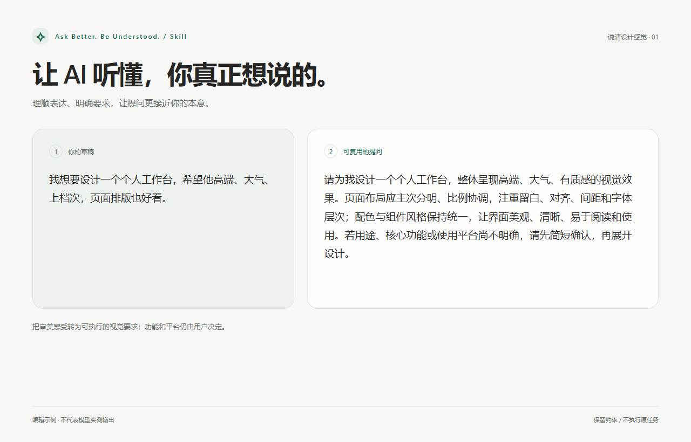

# Ask Better. Be Understood.

[English](README.md) · Skill · 1.0.0-preview.1

**把想法表达清楚，让下一次提问更接近你的本意。**



知道自己想要什么，却一时说不清怎么问？把草稿交给这个 Skill。它整理语序、澄清已有要求，返回一段可继续编辑和复用的提示词。你决定目标，它帮助表达。

## 从一句原话开始

```text
请用 $ask-better-be-understood 整理下面这段提示词：
我想要设计一个个人工作台，希望他高端、大气、上档次，页面排版也好看。
```

得到的内容仍是一段设计请求，其中的审美要求会更具体；它不会因为这次改写就开始制作工作台。

## 改写时守住什么

| 可以改善 | 必须保留 |
|---|---|
| 语序、重复表达、已有要求的清晰度 | 原意、语言、范围和明确约束 |
| 适合这段需求的组织方式 | 名称、数字、路径、链接和引用代码 |
| 必要资料的补充要求 | 用户决定功能、技术、预算和期限的权利 |

已有表达足够清楚时，可以少改或原样返回。默认只交付完善正文；需要解释时，请明确要求附修改说明。没有其他篇幅要求时，约 1000 字符是软目标，不能因此截断原有要求。

## 放入你的工作环境

将 `skills/ask-better-be-understood` 放入当前 Codex 环境支持的 Skill 目录，必要时刷新技能发现或开启新会话。通过 `$ask-better-be-understood` 加原文调用，或明确提出完善提示词的请求。普通问答和任务请求仍按原本用途处理。

Skill 处理的是已提供的文本。输入框旁的完善栏、自动回填、撤销和结果窗口，需要另行使用 Windows 辅助程序。草稿中的命令不会成为本次改写时读取文件、浏览网页或执行任务的指令。

## 查看规则与例子

[中文运作规则](docs/SKILL.zh-CN.md) · [四组双语案例](skills/ask-better-be-understood/references/examples.md) · [行为验证](docs/verification.md)

案例涵盖设计表达、邮件沟通、反馈整理和配置解释。个人工作台原话由用户指定，其余为虚构通用需求；完善稿为编辑示例，不冒充模型实测结果。模型输出仍需用户阅读确认，模型服务的数据政策和额度规则继续适用。

## 许可与下载

[MIT 许可证](LICENSE) · Copyright (c) 2026 ALeon520。

[下载 Skill 安装包](https://github.com/ALeon520/ask-better-be-understood-skill/releases/download/v1.0.0-preview.1/ask-better-be-understood-skill-1.0.0-preview.1.zip) · [版本说明与源码包](https://github.com/ALeon520/ask-better-be-understood-skill/releases/tag/v1.0.0-preview.1) · [Windows 桌面工具](https://github.com/ALeon520/ask-better-be-understood-windows)。

安装包包含 Skill 本体及许可证；仓库另有双语说明、示例和展示素材。1.0.0-preview.1 为预发布版，采用前请查看验证范围。[素材说明](docs/assets/README.md)。
